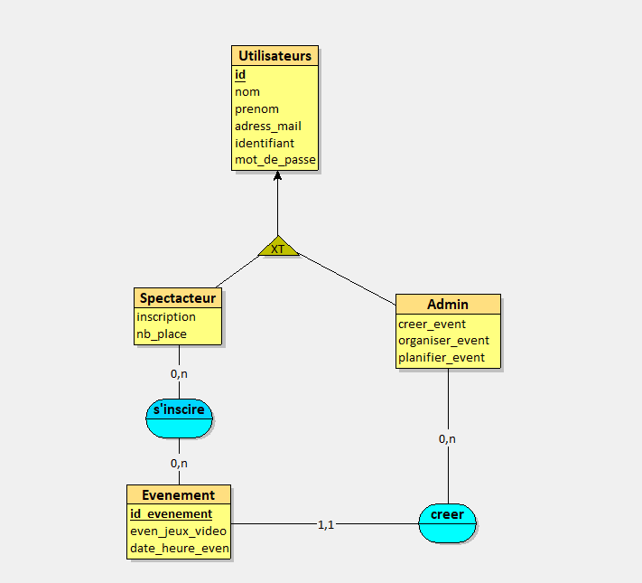

# Tournois e-sport de l'hôtel

<div align="center">


**Application web de gestion d'événements autour du jeu vidéo**

[À propos](#-à-propos) • [Fonctionnalités](#-fonctionnalités) • [Installation](#-installation) • [Base de données](#-base-de-données) • [Structure](#-structure-du-projet) • [État du projet](#-état-du-projet)

</div>

---

##  À propos

Ce projet est réalisé dans le cadre du **BTS SIO, deuxième année**. Il a pour objectif de mettre en place un site permettant à un hôtel de proposer et gérer des événements de jeu vidéo.

Le site doit permettre aux visiteurs de consulter l'agenda des tournois, aux clients de créer un compte et de s'inscrire aux événements, et aux administrateurs de gérer les activités proposées.

> **Cadre scolaire :** application PHP/MySQL développée pour apprendre la conception d'une base de données, les requêtes dynamiques et l'organisation d'une application web.

---

##  Fonctionnalités

| Fonctionnalité | Description | Statut |
|---|---|---|
| Agenda des événements | Affichage des tournois et des dates | Disponible |
| Filtrage par date | Consultation des événements d'une journée | Disponible |
| Connexion | Authentification d'un utilisateur | À sécuriser |
| Création de compte | Enregistrement d'un nouvel utilisateur | À finaliser |
| Espace client | Consultation des inscriptions | En cours |
| Inscription à un tournoi | Réservation depuis l'agenda | En cours |
| Espace administrateur | Consultation des événements | En cours |
| Ajout d'événement | Interface prévue pour les administrateurs | En cours |
| Thème clair/sombre | Modification de l'apparence du site | Disponible |

---

##  Aperçu

### Modèle conceptuel de données



Le MCD définit les utilisateurs, les spectateurs, les administrateurs, les événements et les inscriptions.

---

##  Technologies utilisées

- **PHP** — partie back serveur et génération des pages
- **MySQL** — base de données
- **MySQL** — connexion et requêtes préparées
- **HTML5 / CSS** — structure et mise en forme
- **JavaScript** — interactions côté navigateur (ex. jour/nuit)
- **XAMPP** — environnement local pour tester

---

##  Installation

### Prérequis

- PHP 8 ou supérieur
- MySQL
- Apache
- navigateur web
- environnement  XAMPP

### 1. Cloner le projet

```bash
git clone https://github.com/Fkn130/fraude_fiscale.git
cd fraude_fiscale
```

### 2. Créer la base de données

1. Ouvrir phpMyAdmin.
2. Créer une base nommée `fraude_fiscale_hotel_bdd` ou choisir un autre nom.
3. Importer le fichier `scrip.sql`.
4. Importer ensuite le jeu de données `ajout_donner.sql`.

```text
1. scrip.sql
2. ajout_donner.sql
```

### 3. Configurer la connexion

Modifier `script/bdd.php` avec les identifiants locaux :

```php
$host = "localhost";
$dbname = "lenalaravel_hotel_bdd";
$user = "utilisateur_mysql";
$password = "mot_de_passe_mysql";
```

> Ne commitez jamais de mot de passe réel dans le dépôt. Préférez des variables d'environnement pour l'hébergement.

### 4. Lancer le site

Placer le dépôt dans le dossier `htdocs` de XAMPP ou `www` de WAMP, puis ouvrir :

```text
http://localhost/fraude_fiscale/site/login/index.php
```

---

##  Base de données

Le schéma principal contient cinq tables :

| Table | Rôle |
|---|---|
| `Utilisateurs` | Informations personnelles et identifiants de connexion |
| `Spectacteur` | Informations liées aux spectateurs |
| `Admin` | Droits d'administration |
| `Evenement` | Jeux, dates et administrateurs responsables |
| `sinscire` | Relation entre les utilisateurs et les événements |

Les données d'exemple sont disponibles dans `ajout_donner.sql`.

---

##  Structure du projet

```text
fraude_fiscale/
├── css/
│   └── style.css              # Mise en forme et thèmes
├── element/
│   ├── header.php             # En-tête HTML commun
│   ├── nav.php                # Navigation commune
│   └── footer.php             # Pied de page et script JS
├── images/
│   └── logo.png               # Logo du projet
├── js/
│   └── script.js              # Interactions JavaScript
├── log/
│   └── log.php                # Gestion des logs
├── script/
│   ├── bdd.php                # Connexion à MySQL
│   ├── login.php              # Connexion et création de compte
│   ├── table_event.php        # Chargement des événements
│   └── inscription_event.php  # Traitement prévu des inscriptions
├── site/login/
│   ├── index.php              # Agenda des événements
│   ├── page_connexion.php     # Connexion et création de compte
│   ├── espace_client.php      # Espace utilisateur
│   ├── admin.php              # Interface administrateur
│   └── ajout_evenement.php    # Ajout d'événement
├── ajout_donner.sql           # Jeu de données
├── scrip.sql                  # Schéma de la base
├── mcd.png                    # Modèle conceptuel
└── Liste_pb.md                # Liste détaillée des problèmes
```

---

##  État du projet

Les écrans principaux et une première partie de la logique PHP/MySQL sont présents. Plusieurs points doivent encore être corrigés avant une mise en production :

- retirer les identifiants de base du code ;
- harmoniser les noms de colonnes SQL ;
- sécuriser les connexions et les mots de passe ;
- finaliser les inscriptions aux événements ;
- afficher les réservations dans l'espace client ;
- protéger les pages administrateur côté serveur ;
- corriger les chemins relatifs, le HTML et les validations JavaScript.

La liste complète des anomalies et les priorités de correction sont détaillées dans [Liste_pb.md](./Liste_pb.md).

---

##  Ressources du dépôt

- [Schéma SQL](./scrip.sql)
- [Jeu de données](./ajout_donner.sql)
- [Modèle conceptuel](./mcd.png)
- [Liste des problèmes](./Liste_pb.md)

---

<div align="center">

Projet BTS SIO — Gestion d'événements de jeux vidéo

</div>
